# 🔊 Sounds - Drum Set

The nine drum sounds the pads play. `js/app.js` loads them as `sounds/<name>.wav`.

## Contents

- [`boom.wav`](boom.wav) — G
- [`clap.wav`](clap.wav) — A
- [`hihat.wav`](hihat.wav) — S
- [`kick.wav`](kick.wav) — D
- [`openhat.wav`](openhat.wav) — F
- [`ride.wav`](ride.wav) — H
- [`snare.wav`](snare.wav) — J
- [`tink.wav`](tink.wav) — L
- [`tom.wav`](tom.wav) — K
- [`PUT_SOUNDS_HERE.txt`](PUT_SOUNDS_HERE.txt) — the expected file names

---

## 👤 Author

**Kevin Cusnir 'Lirioth'**  
Repository: [Fullstack2026](https://github.com/LiriothTeltanion/Fullstack2026)  
Week 3 Day 5 - Mini-projects - Drum Set
