# 🎮 Day 5 — Mini-projects

<div align="center">




</div>

Create interactive browser experiences with JavaScript, DOM events, accessibility, and responsive behavior.

## Contents

- [`DailyChallenge/`](DailyChallenge/)
- [`Exercises/`](Exercises/)

## Run

From the repository root:

```bash
python -m http.server 8000
node Week3JavaScriptandDOM/Day5MiniProject/Exercises/MiniProjectColoringGame/script.js
```
