# 🌐 Week 3 — JavaScript and the DOM

My first week of JavaScript. It starts with arrays and loops and ends with DOM events, timers and small browser projects. Most folders are web pages: open their `index.html`, or run `npm run dev` from the repo root and go to `http://localhost:8000/`.

## Contents

| Folder | Topic | Repository entries |
|---|---|---:|
| [Day1IntroductiontoJavaScript/](Day1IntroductiontoJavaScript/) | Day 1 — Introduction to JavaScript | 6 |
| [Day2FunctionsandDOMIntroduction/](Day2FunctionsandDOMIntroduction/) | Day 2 — Functions and DOM Introduction | 7 |
| [Day3LearningDOMEvents/](Day3LearningDOMEvents/) | Day 3 — DOM Events | 7 |
| [Day4AdvancedJavaScriptFunctions/](Day4AdvancedJavaScriptFunctions/) | Day 4 — Advanced JavaScript Functions | 4 |
| [Day5MiniProject/](Day5MiniProject/) | Day 5 — Mini-projects | 3 |
| [RemoteLearningJSAndDOM/](RemoteLearningJSAndDOM/) | Remote Learning — JavaScript and the DOM | 8 |

---

## 👤 Author

**Kevin Cusnir 'Lirioth'**  
Repository: [Fullstack2026](https://github.com/LiriothTeltanion/Fullstack2026)  
Week 3 - JavaScript and the DOM

Navigation verified 2026-11-25. Entries link to available code and run instructions.
