# 🥉 Exercises XP 1

Four small browser apps. Each folder has its own `index.html`, `css/` and `js/`.

## Contents

- [`exercise1_todo/`](exercise1_todo/) — a to-do list with filters, saved in `localStorage`
- [`exercise2_color_guess/`](exercise2_color_guess/) — guess the `rgb()` value of a random color
- [`exercise3_calculator/`](exercise3_calculator/) — a calculator with memory keys
- [`exercise4_whack_a_mole/`](exercise4_whack_a_mole/) — a 30-second game with top-5 high scores

---

## 👤 Author

**Kevin Cusnir 'Lirioth'**  
Repository: [Fullstack2026](https://github.com/LiriothTeltanion/Fullstack2026)  
Week 3 Remote Learning - JavaScript and the DOM - Exercises XP 1
