# 🧪 Exercise 1 - Todo List

A to-do app with filters that remembers the list in the browser's `localStorage`.

## ▶️ How to run

Open `index.html` in a browser (or run `npm run dev` from the repo root and open this folder at `http://localhost:8000/`). `js/app.js` uses `document` and `localStorage`, so it only runs in the browser, not with `node`.

## 🎯 The challenge

| Function | What it does |
|---|---|
| `addTodo()` | Adds the trimmed text as `{ id, text, done: false }` (button or Enter); empty text is ignored. |
| `toggle(id)` | Flips `done` when the checkbox is clicked. |
| `removeOne(id)` / `removeAll()` | Remove one task, or all of them with **Remove All**. |
| `render()` | Redraws the list for the current filter (All, Active, Completed), updates the `N items` counter and disables **Remove All** when the list is empty. |
| `save()` | Writes the list to `localStorage` under `todos_v1`. |

## 🧠 What I learned

- `localStorage` only stores strings, so I save with `JSON.stringify` and load with `JSON.parse`
- Redrawing everything from one array keeps the page and the data in sync
- One click listener on the `<ul>` handles every checkbox and Remove button
- Setting `textContent` for the task text avoids putting user input into HTML

---

## 👤 Author

**Kevin Cusnir 'Lirioth'**  
Repository: [Fullstack2026](https://github.com/LiriothTeltanion/Fullstack2026)  
Week 3 Remote Learning - JavaScript and the DOM - Exercise 1
