# 🎨 Styles - Todo List

A dark Material-style look: purple buttons, teal filter chips when active, and a line through completed tasks.

## Contents

- [`styles.css`](styles.css): theme variables, the add bar, the `.chip.active` filters, the task rows and an `.sr-only` helper for hidden labels

---

## 👤 Author

**Kevin Cusnir 'Lirioth'**  
Repository: [Fullstack2026](https://github.com/LiriothTeltanion/Fullstack2026)  
Week 3 Remote Learning - JavaScript and the DOM - Todo List
