# 📜 Scripts - Todo List

The browser script for the Todo List. It needs the page, so open `../index.html` instead of running it with `node`.

## Contents

- [`app.js`](app.js) — add, toggle, remove and filter tasks, saved in `localStorage`

---

## 👤 Author

**Kevin Cusnir 'Lirioth'**  
Repository: [Fullstack2026](https://github.com/LiriothTeltanion/Fullstack2026)  
Week 3 Remote Learning - JavaScript and the DOM - Todo List
