# 🧪 Exercise 2 - Color Guess

A guessing game for colors. The page paints a random color, and I have to work out its `rgb()` value.

## ▶️ How to run

Open `index.html` in a browser (or use `npm run dev` from the repo root and open this folder). Pick a difficulty and start guessing.

## 🎯 The challenge

| Function | What it does |
|---|---|
| `newRound()` | Picks a random target color. Easy shows 3 `rgb()` buttons, Medium shows 6, Hard shows three R / G / B number inputs. |
| `guessArray(guess)` | Checks a button guess, marks every button as `correct` or `wrong` and disables them. |
| `guessHard()` | Checks the three typed numbers against the exact target. |
| `endRound(correct)` | Shows `✅ Correct!` or `❌ Not quite.`; after a correct guess, counts down 5 seconds and starts a new round. |

**Next Color** starts a new round at any time, and so does changing the difficulty. Hard mode is honestly hard: the three numbers have to match exactly, with no "close enough".

## 🧠 What I learned

- `rand()` is just `Math.floor(Math.random() * 256)`, one channel from 0 to 255, called three times
- The countdown is a `setInterval` that lowers `remain` every second and starts a round at 0
- `/\d+/g` pulls the three numbers back out of a button's `rgb()` text so I can compare them
- `newRound()` clears the old `timer` first, otherwise two countdowns could overlap

---

## 👤 Author

**Kevin Cusnir 'Lirioth'**  
Repository: [Fullstack2026](https://github.com/LiriothTeltanion/Fullstack2026)  
Week 3 Remote Learning - JavaScript and the DOM - Exercise 2
