# 🎨 Styles - Color Guess

Navy panels with a big color swatch on top, the answer buttons in a three-column grid, and green or red outlines once I guess.

## Contents

- [`styles.css`](styles.css): theme variables, the 140px `.swatch`, the `.grid` of options with `.correct` / `.wrong`, and `.hard.hide` to hide the number inputs

---

## 👤 Author

**Kevin Cusnir 'Lirioth'**  
Repository: [Fullstack2026](https://github.com/LiriothTeltanion/Fullstack2026)  
Week 3 Remote Learning - JavaScript and the DOM - Color Guess
