# 🧪 Exercise 3 - Calculator

<div align="center">




</div>

A calculator with the four operations, sign change, percent and memory keys.

## ▶️ How to run

Open `index.html` in a browser (or run `npm run dev` from the repo root and open this folder at `http://localhost:8000/`). `js/app.js` needs the page, so it does not run with `node`.

```
7 + 5 × 2 =   →  24   (each operator works on the running total)
9 ÷ 0 =       →  NaN
```

## 🎯 The challenge

| Function | What it does |
|---|---|
| `inputDigit(ch)` | Starts a new number or adds a digit; a second `.` is ignored. |
| `doOp(next)` | Applies the pending operator to the running total `acc`, then stores the next one. |
| `compute(x, y, op)` | Does `+`, `-`, `*` and `/`; dividing by 0 returns `NaN`. |
| `equals()` | Finishes the pending operation and shows the result. |
| `clearAll()`, `toggleSign()`, `percent()` | The `C`, `±` and `%` keys. |
| `mplus()`, `mminus()`, `mr()`, `mc()` | Add to, subtract from, recall and clear the memory. |

`setDisplay()` switches to scientific notation when the result is longer than 14 characters. One click listener on the keypad reads `data-num`, `data-op` and `data-act` to decide what each button does.

## 🧠 What I learned

- A calculator needs a little state: the total, the pending operator and a "new number" flag
- `data-*` attributes let one listener handle the whole keypad
- A `switch` keeps the operator logic short and easy to read
- Without operator precedence, `7 + 5 × 2` gives 24, not 17

---

## 👤 Author

**Kevin Cusnir 'Lirioth'**  
Repository: [Fullstack2026](https://github.com/LiriothTeltanion/Fullstack2026)  
Week 3 Remote Learning - JavaScript and the DOM - Exercise 3
