# 🎨 Styles - Calculator

The keypad is a four-column CSS grid. Operator keys are slate, `=` is green, and the wide `0` key spans two columns.

## Contents

- [`styles.css`](styles.css): the dark panel, a right-aligned 32px display, the key grid and a 1px press effect on `:active`

---

## 👤 Author

**Kevin Cusnir 'Lirioth'**  
Repository: [Fullstack2026](https://github.com/LiriothTeltanion/Fullstack2026)  
Week 3 Remote Learning - JavaScript and the DOM - Calculator
