# 📜 Scripts - Calculator

Everything the keys do lives in this one file, driven by a single `click` listener on the keypad. It needs `../index.html` around it to run.

## Contents

- [`app.js`](app.js): digit input, the running-total operators, `=`, `C`, `±`, `%` and the four memory keys

---

## 👤 Author

**Kevin Cusnir 'Lirioth'**  
Repository: [Fullstack2026](https://github.com/LiriothTeltanion/Fullstack2026)  
Week 3 Remote Learning - JavaScript and the DOM - Calculator
