# 🧪 Exercise 4 - Whack-a-Mole

A 30-second Whack-a-Mole game with a top-5 high score table saved in the browser.

## ▶️ How to run

Open `index.html` in a browser (or use `npm run dev` from the repo root and open this folder), then click **Start (30s)** and click the hamster 🐹 as often as you can.

## 🎯 The challenge

| Function | What it does |
|---|---|
| `buildGrid()` | Creates 9 hole buttons and one click listener for the whole grid. |
| `spawnMole()` | Clears every hole and puts the mole in a random one. |
| `startGame()` | Resets the score and the time, then starts two intervals: the clock every second and a new mole every 800 ms. |
| `onCellClick(e)` | Adds a point when the clicked hole has the mole, and moves the mole right away. |
| `endGame()` | Stops both intervals, shows `Done!` and checks the high scores. |
| `maybeRecordHighScore(sc)` | If the score makes the top 5, asks for a name, sorts the list and keeps 5 entries in `localStorage`. |

## 🧠 What I learned

- Two `setInterval` timers can run side by side, and each needs its own `clearInterval`
- `localStorage` keeps the high scores after the page is closed
- Sorting by score and then by time keeps older ties first
- Optional chaining (`list[4]?.score ?? -1`) handles a list with fewer than 5 scores

---

## 👤 Author

**Kevin Cusnir 'Lirioth'**  
Repository: [Fullstack2026](https://github.com/LiriothTeltanion/Fullstack2026)  
Week 3 Remote Learning - JavaScript and the DOM - Exercise 4
