# 🎨 Styles - Whack-a-Mole

A 3 × 3 grid of 120px holes. The hamster hole gets a faint cyan ring, and `user-select: none` keeps fast clicks from selecting the emoji.

## Contents

- [`styles.css`](styles.css): theme variables, the top bar, the `.grid` of `.cell` buttons, the `.cell.active` look and the scores area

---

## 👤 Author

**Kevin Cusnir 'Lirioth'**  
Repository: [Fullstack2026](https://github.com/LiriothTeltanion/Fullstack2026)  
Week 3 Remote Learning - JavaScript and the DOM - Whack-a-Mole
