# 📜 Scripts - Whack-a-Mole

The browser script for Whack-a-Mole. It needs the page, so open `../index.html` instead of running it with `node`.

## Contents

- [`app.js`](app.js) — builds the grid, runs the 30-second game and keeps the top 5 scores in `localStorage`

---

## 👤 Author

**Kevin Cusnir 'Lirioth'**  
Repository: [Fullstack2026](https://github.com/LiriothTeltanion/Fullstack2026)  
Week 3 Remote Learning - JavaScript and the DOM - Whack-a-Mole
