# 🥉 Exercises XP 2

Three exercises about timing and movement. Every folder has its own `index.html` and `js/`, with the CSS inside the page.

## Contents

- [`exercise1_timer/`](exercise1_timer/): two `setTimeout` calls and an interval that stops at 5 paragraphs
- [`exercise2_move_box/`](exercise2_move_box/): a box sliding 1px per millisecond to the edge
- [`exercise3_drag_drop/`](exercise3_drag_drop/): drag a box into a target with pointer events

---

## 👤 Author

**Kevin Cusnir 'Lirioth'**  
Repository: [Fullstack2026](https://github.com/LiriothTeltanion/Fullstack2026)  
Week 3 Remote Learning - JavaScript and the DOM - Exercises XP 2
