# 🧪 Exercise 1 - Timer

A timer exercise in three parts: an alert after 2 seconds, a paragraph after 2 seconds, and a new paragraph every 2 seconds until I stop it.

## ▶️ How to run

Open `index.html` in a browser (or run `npm run dev` from the repo root and open this folder at `http://localhost:8000/`). The timers start on load. `js/app.js` needs the page, so it does not run with `node`.

## 🎯 The challenge

1. **Part I** – `setTimeout` shows `alert("Hello World")` after 2 seconds.
2. **Part II** – another `setTimeout` adds `
Hello World
` to `#container` after 2 seconds.
3. **Part III** – `setInterval` adds a paragraph every 2 seconds and stops when there are 5 paragraphs, or when I click **Clear Interval**.

`addParagraph(text)` creates and appends each paragraph, so Parts II and III share the same code.

## 🧠 What I learned

- `setTimeout` runs once after a delay, `setInterval` keeps going
- `clearInterval(id)` needs the id that `setInterval` returned
- Setting the id to `null` after clearing makes the button safe to click twice
- Counting the `
` elements is an easy way to know when to stop

---

## 👤 Author

**Kevin Cusnir 'Lirioth'**  
Repository: [Fullstack2026](https://github.com/LiriothTeltanion/Fullstack2026)  
Week 3 Remote Learning - JavaScript and the DOM - Exercise 1
