# 📜 Scripts - Timer

The browser script for the Timer exercise. It needs the page, so open `../index.html` instead of running it with `node`.

## Contents

- [`app.js`](app.js) — the 2-second alert, the 2-second paragraph and the paragraph interval that stops at 5 or on **Clear Interval**

---

## 👤 Author

**Kevin Cusnir 'Lirioth'**  
Repository: [Fullstack2026](https://github.com/LiriothTeltanion/Fullstack2026)  
Week 3 Remote Learning - JavaScript and the DOM - Timer
