# 🧪 Exercise 2 - Move the Box

I click a button and a red box slides 1px every millisecond until it hits the right edge of a yellow square.

## ▶️ How to run

Open `index.html` in a browser (or use `npm run dev` from the repo root and open this folder) and click **Click Me**.

## 🎯 The challenge

- `myMove()` first clears an animation that is already running, so two intervals never stack.
- It reads where the box is now with `getComputedStyle` and works out the limit: container width minus box width (400 − 50 = 350px).
- If the box is already at the edge, it jumps back to `left: 0` so the next click slides it again.
- `setInterval(..., 1)` adds 1px to `left` each tick and clears itself once the box reaches the limit.

## 🧠 What I learned

- `getComputedStyle(box).left` gives the real position even when it was only set in CSS
- `clientWidth` of the container and of the box is all I need to find the stop point
- Clearing `moveInterval` before a new start keeps the speed at 1px per tick
- `left` only moves the box because it is `position: absolute` inside a `position: relative` container

---

## 👤 Author

**Kevin Cusnir 'Lirioth'**  
Repository: [Fullstack2026](https://github.com/LiriothTeltanion/Fullstack2026)  
Week 3 Remote Learning - JavaScript and the DOM - Exercise 2
