# 📜 Scripts - Move the Box

Just one function, `myMove()`, which the button's click calls. It needs the box and container from `../index.html`.

## Contents

- [`app.js`](app.js): reads the current `left`, computes the 350px limit, goes back to the left if the box is already there and steps the box with a 1 ms interval

---

## 👤 Author

**Kevin Cusnir 'Lirioth'**  
Repository: [Fullstack2026](https://github.com/LiriothTeltanion/Fullstack2026)  
Week 3 Remote Learning - JavaScript and the DOM - Move the Box
