# 🧪 Exercise 3 - Drag and Drop

I drag a red box into a yellow target. If I drop it fully inside, it centers itself. If any part sticks out, it jumps back to where it started.

## ▶️ How to run

Open `index.html` in a browser (or use `npm run dev` from the repo root and open this folder), then drag the red box with the mouse or a finger.

## 🎯 The challenge

| Handler / function | What it does |
|---|---|
| `pointerdown` | Starts dragging, captures the pointer and remembers where the pointer and the box started. |
| `pointermove` | Moves the box by the distance the pointer has travelled. |
| `isInsideTarget(el, tgt)` | Compares the two `getBoundingClientRect()` boxes to see if the box is fully inside the target. |
| `pointerup` | Centers the box in the target, or sends it back to its original place. |

I used pointer events instead of the HTML drag-and-drop API, and the box has `touch-action: none` so a finger drag moves it instead of scrolling the page.

## 🧠 What I learned

- One set of `pointerdown` / `pointermove` / `pointerup` listeners covers both mouse and touch
- After `setPointerCapture`, the box keeps getting `pointermove` even when the pointer slips off it
- "Fully inside" is four comparisons between the two rectangles from `getBoundingClientRect()`
- I save `offsetLeft` and `offsetTop` once at the start, and that is all "snap back" needs

---

## 👤 Author

**Kevin Cusnir 'Lirioth'**  
Repository: [Fullstack2026](https://github.com/LiriothTeltanion/Fullstack2026)  
Week 3 Remote Learning - JavaScript and the DOM - Exercise 3
