# 📜 Scripts - Drag and Drop

Three pointer listeners on the box (`pointerdown`, `pointermove`, `pointerup`) and one helper that checks the drop. Open `../index.html` to try it.

## Contents

- [`app.js`](app.js): drags the box with pointer capture, then centers it in the target or snaps it back

---

## 👤 Author

**Kevin Cusnir 'Lirioth'**  
Repository: [Fullstack2026](https://github.com/LiriothTeltanion/Fullstack2026)  
Week 3 Remote Learning - JavaScript and the DOM - Drag and Drop
