# 🧪 Remote Exercise - Optional JS Exercises

<div align="center">




</div>

Six string exercises with a small page around them. The functions live in [`js/exercises.js`](js/exercises.js) and never touch the DOM, so the page and a terminal demo share the same code.

## ▶️ How to run

The page loads its script as an ES module, which browsers block on `file://`, so I serve the folder:

```bash
python -m http.server 8000
```

Then open `http://localhost:8000`, type a sentence, pick an exercise and press **Run**. To see every function at once in the terminal:

```bash
node js/demo.js
```

```
1. reverseString: tpircSavaJ
2. countVowels: 11
3. capitalizeWords: The Quick Brown Fox Jumps Over The Lazy Dog
4. longestWord: quick
5. isPalindrome: true false
6. chunkWords: [
  [ 'the', 'quick', 'brown', 'fox' ],
  [ 'jumps', 'over', 'the', 'lazy' ],
  [ 'dog' ]
]
```

## 🎯 The challenge

| Function | What it does |
|---|---|
| `reverseString(text)` | Builds the string backwards with a `for` loop, no `.reverse()` |
| `countVowels(text)` | Counts `a e i o u` after `toLowerCase()` |
| `capitalizeWords(text)` | Uppercases the first letter of every word and lowercases the rest |
| `longestWord(text)` | Returns the longest word; on a tie the first one wins (`quick` beats `brown` and `jumps`) |
| `isPalindrome(text)` | Removes everything except letters and digits, then compares with the reversed text |
| `chunkWords(text, size)` | Splits the words into groups with `slice()` |

[`js/app.js`](js/app.js) maps each `<option>` value to a function in a `runners` object and writes the answer into an `aria-live` paragraph.

## 🧠 What I learned

- Keeping the functions free of `document` let me run the same file in Node with `demo.js`
- `<script type="module">` needs a server, which is why double-clicking `index.html` showed nothing
- An object of functions (`runners[select.value]`) replaced a six-branch `if` chain
- `replace(/[^a-z0-9]/g, "")` is what makes "Never odd or even" count as a palindrome

---

## 👤 Author

**Kevin Cusnir 'Lirioth'**  
Repository: [Fullstack2026](https://github.com/LiriothTeltanion/Fullstack2026)  
Week 3 Remote Learning - JavaScript and the DOM - Remote Exercise
