# 🎨 Styles - Optional JS Exercises

The one stylesheet for `../index.html`: a dark card around the form, and a visible focus ring for keyboard users.

## Contents

- [`style.css`](style.css): colour variables on `:root`, the form card, inputs, the Run button and the output line

---

## 👤 Author

**Kevin Cusnir 'Lirioth'**  
Repository: [Fullstack2026](https://github.com/LiriothTeltanion/Fullstack2026)  
Week 3 Remote Learning - JavaScript and the DOM - Optional JS Exercises
