# 📜 Scripts - Optional JS Exercises

Three ES modules: the exercises themselves, the page wiring, and a terminal demo that reuses the same functions.

## Contents

- [`exercises.js`](exercises.js): the six exported functions, with no DOM code
- [`app.js`](app.js): reads the form, calls the chosen function and shows the answer
- [`demo.js`](demo.js): `node js/demo.js` runs every exercise once in the terminal

---

## 👤 Author

**Kevin Cusnir 'Lirioth'**  
Repository: [Fullstack2026](https://github.com/LiriothTeltanion/Fullstack2026)  
Week 3 Remote Learning - JavaScript and the DOM - Optional JS Exercises
