# Exercises

<div align="center">




</div>

Create interactive browser experiences with JavaScript, DOM events, accessibility, and responsive behavior.

## Contents

- [`ExercisesXP1/`](ExercisesXP1/)
- [`ExercisesXP2/`](ExercisesXP2/)

## Run

From the repository root:

```bash
python -m http.server 8000
node Week3JavaScriptandDOM/RemoteLearningJSAndDOM/Exercises/ExercisesXP1/exercise1_todo/js/app.js
```
