# 🛰️ Remote Learning — JavaScript and the DOM

Extra JavaScript and DOM practice I did in the remote learning sessions: four small apps, then timers and drag and drop.

## Contents

| Folder | What it is |
|---|---|
| [`Exercises/`](Exercises/) | Exercises XP 1 and Exercises XP 2 |

---

## 👤 Author

**Kevin Cusnir 'Lirioth'**  
Repository: [Fullstack2026](https://github.com/LiriothTeltanion/Fullstack2026)  
Week 3 Remote Learning - JavaScript and the DOM
