# 💪 Daily Challenge - Car Inventory

<div align="center">




</div>

A small page with a list of five cars: one button finds the first Honda and another shows the cars sorted by year.

## ▶️ How to run

Open `index.html` in a browser, or run `npm run dev` from the repository root and go to `http://localhost:8000/Week4AdvAsynchronousJavaScript/Day1AdvancedArrayMethods/DailyChallenge/CarInventory/`.

The first Honda shows up on load:

```
✅ This is a Honda Accord from 1983.
```

## 🎯 The challenge

| Function | What it does |
|---|---|
| `getCarHonda(carInventory)` | Uses `find` to get the first Honda and returns a sentence about it, or `🙈 No Honda found in the inventory.` |
| `sortCarInventoryByYear(carInventory)` | Returns a new array sorted by `car_year`, oldest first, without changing the original |

**Sort Inventory** draws one card per car. Both functions are also on `window`, so I can call them from the DevTools console.

## 🧠 What I learned

- `find` returns the first match or `undefined`
- `sort` changes the array in place, so I sort a copy (`[...carInventory]`)
- `(a, b) => a.car_year - b.car_year` sorts numbers in ascending order

---

## 👤 Author

**Kevin Cusnir 'Lirioth'**  
Repository: [Fullstack2026](https://github.com/LiriothTeltanion/Fullstack2026)  
Week 4 Day 1 - Advanced Array Methods - Daily Challenge
