# 📜 Scripts - Car Inventory

The Car Inventory script. It needs `document`, so I load it through `../index.html` instead of running it with Node.

## Contents

- [`app.js`](app.js): the five cars, `getCarHonda()`, `sortCarInventoryByYear()` and the two button handlers

---

## 👤 Author

**Kevin Cusnir 'Lirioth'**  
Repository: [Fullstack2026](https://github.com/LiriothTeltanion/Fullstack2026)  
Week 4 Day 1 - Advanced Array Methods - Car Inventory
