# 💪 Daily Challenge - Go Wildcats

<div align="center">




</div>

`gameInfo` holds four players with a team, a score and some items. Three `forEach` loops turn it into a list of usernames, a list of winners and one total score.

## ▶️ How to run

From this folder:

```bash
npx tsc GoWildcats.ts --module commonjs --outDir ~/tmp-ts
node ~/tmp-ts/GoWildcats.js
```

The console demo sits behind `require.main === module`, which only exists in CommonJS. The repo's `package.json` says `"type": "module"`, so I compile to a folder outside the repository and run it from there.

```
usernames: [ 'john!', 'becky!', 'susy!', 'tyson!' ]
winners: [ 'becky', 'susy' ]
totalScore: 71
```

## 🎯 The challenge

1. **`usernames`**: each username with `"!"` added at the end.
2. **`winners`**: the usernames whose score is above 5. John has exactly 5, so he is not a winner.
3. **`totalScore`**: 5 + 10 + 55 + 1, added up in a `let` counter.

All three are exported. A comment at the bottom shows the same results with `map`, `filter` and `reduce`, as a reference only.

## 🧠 What I learned

- `forEach` has no return value, so the result has to live in an array or counter declared outside the loop
- The `filter` + `map` version of the winners is shorter, but the prompt asked for `forEach`
- Typing the players with a `Player` type means a typo like `p.scor` fails at compile time

---

## 👤 Author

**Kevin Cusnir 'Lirioth'**  
Repository: [Fullstack2026](https://github.com/LiriothTeltanion/Fullstack2026)  
Week 4 Day 1 - Advanced Array Methods - Daily Challenge
