# 💪 Daily Challenges

Two daily challenges for Day 1, one in the browser and one in TypeScript.

## Contents

- [`CarInventory/`](CarInventory/): finds the first Honda and sorts the cars by year on a web page
- [`GoWildcats/`](GoWildcats/): usernames, winners and a total score built with `forEach`

---

## 👤 Author

**Kevin Cusnir 'Lirioth'**  
Repository: [Fullstack2026](https://github.com/LiriothTeltanion/Fullstack2026)  
Week 4 Day 1 - Advanced Array Methods - Daily Challenges
