# 🥉 Exercises XP

<div align="center">




</div>

Even though it sits under the array day, this XP set is about forms and JSON. Everything is in one HTML file with an inline script: a GET form, a POST form and the Mario game object turned into JSON.

## ▶️ How to run

Open `http_forms_json_exercises.html` in a browser, or serve the repository from its root:

```bash
npm run dev
```

and go to `http://localhost:8000/Week4AdvAsynchronousJavaScript/Day1AdvancedArrayMethods/Exercises/ExercisesXP/http_forms_json_exercises.html`.

## 🎯 The challenge

1. **GET form**: `name` and `message` go back to the same page as a query string. On load, `parseQuery()` reads `location.search` with `URLSearchParams`, and `renderGetEcho()` prints the result as JSON next to the full URL.
2. **POST form**: the submit handler calls `preventDefault()`, so nothing is actually sent. It logs `Object.fromEntries(data.entries())` from a `FormData` and shows an alert that tells me to serve the page over HTTP to see a real POST.
3. **JSON Mario**: **Make JSON** writes `marioGame` as a compact string and as a pretty one (`JSON.stringify(marioGame, null, 2)`), then hits a `debugger;` line.

## 🧠 What I learned

- With GET the fields end up in the address bar, with POST they travel in the request body
- Looping over `URLSearchParams` entries turns a query string into a plain object
- Nested objects stay nested after `JSON.stringify`, they just become one string
- `debugger;` only pauses when DevTools is open, otherwise the browser skips it

---

## 👤 Author

**Kevin Cusnir 'Lirioth'**  
Repository: [Fullstack2026](https://github.com/LiriothTeltanion/Fullstack2026)  
Week 4 Day 1 - Advanced Array Methods - Exercises XP
