# 🥇 Exercises XP Gold 2

<div align="center">




</div>

Five short helpers in `ArraysMethodsXPGold.ts`: sum an array, drop duplicates, drop falsy values, repeat a string and line up two emoji racers.

## ▶️ How to run

From this folder:

```bash
npx tsc ArraysMethodsXPGold.ts --module commonjs --outDir ~/tmp-ts
node ~/tmp-ts/ArraysMethodsXPGold.js
```

The output folder is outside the repository because the repo runs `.js` as ES modules, and the guarded demo needs CommonJS to print.

```
E1 sumArray([1,2,3,4]): 10
E2 uniqueArray: [ 1, 2, 3, 4, 5 ]
E3 cleanArray(sample): [ 15, -22, 47 ]
E4 repeat('Ha!', 3): Ha!Ha!Ha!
     ||<- Start line
       🐢
       🐇
turtleAfterPad: 🐢=======
```

## 🎯 The challenge

| Function | What it does |
|---|---|
| `sumArray(nums)` | Adds the numbers with `reduce`, starting from 0 |
| `uniqueArray(arr)` | Puts the array in a `Set` and back into an array with `Array.from` |
| `cleanArray(arr)` | Keeps everything except `null`, `0`, `""`, `false`, `undefined` and `NaN` |
| `repeat(str, n = 1)` | Builds the string in a `for` loop instead of calling `String.prototype.repeat`; `n <= 0` gives `""`. Positive fractional and non-finite positive counts are rejected. |
| `alignRacers()` | Pads the turtle and the rabbit with `padStart(9)` and returns what `trim().padEnd(9, "=")` does to the turtle |

## 🧠 What I learned

- A `Set` keeps only one copy of each value, which makes removing duplicates a one-liner
- `NaN` is never equal to itself, so `cleanArray` needs `Number.isNaN` to catch it
- `padStart` counts UTF-16 code units, and an emoji like 🐢 is two of them, so `padStart(9)` adds only 7 spaces

---

## 👤 Author

**Kevin Cusnir 'Lirioth'**  
Repository: [Fullstack2026](https://github.com/LiriothTeltanion/Fullstack2026)  
Week 4 Day 1 - Advanced Array Methods - Exercises XP Gold 2
