# 🥷 Exercises XP Ninja

<div align="center">




</div>

Five array puzzles in [arrayMethodsNinja.js](arrayMethodsNinja.js), each answered with `reduce`, `filter` or `map` instead of a manual loop.

## ▶️ How to run

```bash
node arrayMethodsNinja.js
```

```
1. Grouped: {
  a: [ 'apple', 'avocado', 'apricot' ],
  b: [ 'banana', 'blueberry' ],
  c: [ 'cherry' ]
}
2. deepFlatten: [ 1, 2, 3, 4, 5, 6, 7, 8 ]
3. Passed: Ray, Jenner, Marco, Jamie
   Average of those who passed: 80.0
4. Duplicates: [ 7, 4 ]
5. Zipped: [ { fruit: 'kiwi', price: 2.5 }, ... ]
```

## 🎯 The challenge

1. **Group by first letter**: `reduce()` starts from `{}` and pushes each word into the array for its letter.
2. **Deep flatten**: `deepFlatten()` calls itself when an item is an array, and the result matches `flat(Infinity)`.
3. **Students**: `filter()` keeps grades of 60 or more, `map()` takes the names, `reduce()` sums the grades for the average.
4. **Duplicates**: `indexOf(value) !== index` finds repeats, and `lastIndexOf(value) === index` reports each one only once.
5. **Zip**: `map()` uses the index to pair every fruit with its price.

## 🧠 What I learned

- The starting value of `reduce()` decides what it builds: `{}` for groups, `[]` for the flat list, `0` for a sum
- Recursion inside `reduce()` handles any depth, the same as `flat(Infinity)`
- 4 appears three times, so without the `lastIndexOf` check it would show up twice in the duplicates

---

## 👤 Author

**Kevin Cusnir 'Lirioth'**  
Repository: [Fullstack2026](https://github.com/LiriothTeltanion/Fullstack2026)  
Week 4 Day 1 - Advanced Array Methods - Exercises XP Ninja
