# 🥷 Exercises XP Ninja 2

<div align="center">




</div>

The second Ninja set, in [arrayMethodsNinja2.js](arrayMethodsNinja2.js), works on a list of five games and uses the newer array methods.

## Menu and string exercises

Run `node menuAndStrings.js` to inspect a menu, tag dishes by ingredient names, split a string, count whole words and reverse an array in place. Chunk sizes must be positive integers. The menu report keeps the original menu intact and only adds a main when needed. [Source](menuAndStrings.js).

## ▶️ How to run

```bash
node arrayMethodsNinja2.js
```

```
1. Sorted:
   Metroidvania  9.1 Hollow Knight
   Metroidvania  8.9 Ori
   Platformer    9 Celeste
   Roguelike     9.3 Hades
   Roguelike     8.7 Dead Cells
   Original first title is still: Hollow Knight
2. Any game before 2016? true
   Every rating above 8.5? true
3. First roguelike: Hades
   Index of Celeste: 1
   Last game from 2018: Dead Cells
4. Games per genre: [ [ 'Metroidvania', 2 ], [ 'Roguelike', 2 ], [ 'Platformer', 1 ] ]
5. Range: [ 10, 20, 30, 40, 50 ]
   Transposed: [ [ 1, 4 ], [ 2, 5 ], [ 3, 6 ] ]
```

## 🎯 The challenge

1. **Sort by two keys** with `toSorted()`: genre A to Z, then rating high to low. The original array keeps its order.
2. **`some()` and `every()`** answer yes/no questions about the whole list.
3. **`find()`, `findIndex()` and `findLast()`** search from the front or from the back.
4. **Count per genre** with `reduce()` and `??`, then sort the `Object.entries()` by count.
5. **`Array.from({ length: 5 }, ...)`** builds a range, and a nested `map()` turns rows into columns.

## 🧠 What I learned

- `a.genre.localeCompare(b.genre) || b.rating - a.rating` only uses the second key when the first one is a tie
- `toSorted()` gave me a sorted copy, so I didn't have to remember that `sort()` changes the array
- Celeste's `9.0` prints as `9`, because a number doesn't keep trailing zeros

---

## 👤 Author

**Kevin Cusnir 'Lirioth'**  
Repository: [Fullstack2026](https://github.com/LiriothTeltanion/Fullstack2026)  
Week 4 Day 1 - Advanced Array Methods - Exercises XP Ninja 2
