# 📚 Exercises

Three exercise sets. The XP one is about forms and JSON, the two Gold ones are about arrays.

## Contents

- [`ExercisesXP/`](ExercisesXP/): one page with a GET form, a POST form and a JSON demo
- [`ExercisesXPGold/`](ExercisesXPGold/): reading `map` and `reduce` output, nested arrays and destructuring
- [`ExercisesXPGold2/`](ExercisesXPGold2/): sum, duplicates, falsy values, a custom `repeat` and `padStart`
- [`ExercisesXPNinja/`](ExercisesXPNinja/): Exercises XP Ninja: to do (optional)
- [`ExercisesXPNinja2/`](ExercisesXPNinja2/): Exercises XP Ninja 2: to do (optional)

---

## 👤 Author

**Kevin Cusnir 'Lirioth'**  
Repository: [Fullstack2026](https://github.com/LiriothTeltanion/Fullstack2026)  
Week 4 Day 1 - Advanced Array Methods - Exercises
