# 🔁 Day 1 — Advanced Array Methods

Array methods day: `find`, `sort`, `forEach`, `map`, `reduce` and `flat`. Most of it is TypeScript, plus two browser pages.

## Contents

| Folder | What it is |
|---|---|
| [`Exercises/`](Exercises/) | The XP page (forms and JSON) and two XP Gold files on arrays |
| [`DailyChallenge/`](DailyChallenge/) | Car Inventory in the browser and Go Wildcats in TypeScript |
| [`Exercises/ExercisesXPNinja/`](Exercises/ExercisesXPNinja/) | Exercises XP Ninja: to do (optional) |
| [`Exercises/ExercisesXPNinja2/`](Exercises/ExercisesXPNinja2/) | Exercises XP Ninja 2: to do (optional) |

---

## 👤 Author

**Kevin Cusnir 'Lirioth'**  
Repository: [Fullstack2026](https://github.com/LiriothTeltanion/Fullstack2026)  
Week 4 Day 1 - Advanced Array Methods
