# 💪 Daily Challenge - Creating Objects

<div align="center">




</div>

`VideoObjects.ts` defines a `Video` with a title, an uploader and a length in seconds. Two videos are made by hand and five more come out of an array.

## ▶️ How to run

From this folder:

```bash
npx tsc VideoObjects.ts --module commonjs --outDir ~/tmp-ts
node ~/tmp-ts/VideoObjects.js
```

The prints are guarded by `require.main === module`, which needs CommonJS, and the repo marks `.js` as ES modules. That is why the compiled file goes to `~/tmp-ts`.

```
Kevin watched all 420 seconds of Intro to TypeScript!
Lirioth watched all 900 seconds of Advanced Array Methods!
Ada watched all 300 seconds of JS Basics!
...
Alex watched all 360 seconds of Testing 101!
```

## 🎯 The challenge

1. **`class Video`**: the constructor stores `title`, `uploader` and `time` as public fields.
2. **`watch()`**: returns `"<uploader> watched all <time> seconds of <title>!"`.
3. **Two instances**: `video1` and `video2`.
4. **Bonus**: `videosData` holds five plain objects typed as `VideoData`, and `map` turns each one into a `Video`.

## 🧠 What I learned

- The class keeps the data and the `watch()` sentence together, so every video formats itself
- For the bonus I chose an array of objects with named fields, which reads better than positional arrays
- Mapping plain data through `new Video(...)` creates all the instances in one line

---

## 👤 Author

**Kevin Cusnir 'Lirioth'**  
Repository: [Fullstack2026](https://github.com/LiriothTeltanion/Fullstack2026)  
Week 4 Day 2 - Advanced Object Methods - Daily Challenge
