# 🥉 Exercises XP

<div align="center">




</div>

Six exercises in `ObjectsDestructuringClassesXP.ts`, going from destructuring to classes and ending with object references.

## ▶️ How to run

From this folder:

```bash
npx tsc ObjectsDestructuringClassesXP.ts --module commonjs --outDir ~/tmp-ts
node ~/tmp-ts/ObjectsDestructuringClassesXP.js
```

Same trick as the other TypeScript files this week: CommonJS output in a folder outside the repo, so the `require.main === module` demo runs. `tsc` prints a TS2839 warning that `[2] === [2]` and `{} === {}` are always false. That is exactly what exercise 6 is about, and the file is still written.

```
I am John Doe from Vancouver, Canada. Latitude(49.2827), Longitude(-123.1207)
Your full name is Elie Schoppik
usersAsEntries: [ [ 'user1', 18273 ], [ 'user2', 92833 ], [ 'user3', 90315 ] ]
usersIdsTimesTwo: [ [ 'user1', 36546 ], [ 'user2', 185666 ], [ 'user3', 180630 ] ]
typeof member: object
eqArrays ([2] === [2]): false
eqObjects ({} === {}): false
vals: { val2: 4, val3: 4, val4: 5 }
Moooo I'm a cow, named Lily and I'm brown and white
```

## 🎯 The challenge

1. **Location**: one destructuring statement pulls `name` (renamed to `pName`), `city`, `country` and the two coordinates out of `person`, and `locationLine` puts them in a sentence.
2. **`displayStudentInfo({ first, last })`**: the parameter itself is destructured, and the function returns `Your full name is ...`.
3. **Users**: `Object.entries(users)` gives `[key, id]` pairs, and a second `map` doubles every id.
4. **`Person`**: `typeof new Person("John")` is `"object"`, not `"Person"`.
5. **`Labrador extends Dog`**: the correct constructor is option 2, which calls `super(name)` and then sets `size`.
6. **References**: `object2` and `object3` point to `object1`, so after `object1.number = 4` both read 4, while `object4` still reads 5. `Mammal.sound("Moooo")` builds the farmer's cow sentence.

## 🧠 What I learned

- Destructuring can rename a field and reach into nested objects and arrays in the same line
- `===` on two arrays or two objects compares where they live in memory, not what is inside
- Assigning an object to a new variable copies the reference, so a change through one name shows up in all of them
- In a subclass, `this` is not usable until `super()` has run

---

## 👤 Author

**Kevin Cusnir 'Lirioth'**  
Repository: [Fullstack2026](https://github.com/LiriothTeltanion/Fullstack2026)  
Week 4 Day 2 - Advanced Object Methods - Exercises XP
