# 🥇 Exercises XP Gold

<div align="center">




</div>

[objectMethodsGold.js](objectMethodsGold.js) has six short exercises with the `Object` helpers and spread.

## Object reports

Run `node objectReports.js`. The name formatter destructures its parameter. The keys and values report sorts the keys once and looks up each corresponding value. Two references to the same counter share all three increments, so the example prints 3. [Source](objectReports.js).

## ▶️ How to run

```bash
node objectMethodsGold.js
```

```
1. Query string: ?genre=rock&year=2024&sort=popular
2. Inverted: { '#ff0000': 'red', '#00ff00': 'green', '#0000ff': 'blue' }
3. Original after changing the shallow copy: [ 'guitar', 'piano', 'drums' ]
   Deep copy did not change: [ 'guitar', 'piano' ]
4. Frozen object: TypeError
   Volume is still 7 | isFrozen: true
5. Merged options: { language: 'es', notifications: true, fontSize: 18 }
6. Value types: { string: 2, number: 2, boolean: 1 }
```

## 🎯 The challenge

1. `Object.entries()` + `map()` + `join("&")` turn a filters object into a query string.
2. `Object.fromEntries()` swaps keys and values in a colour map.
3. `{ ...original }` vs `structuredClone(original)`: pushing into the shallow copy's array also changes the original.
4. `Object.freeze()`: the file is an ES module, so it runs in strict mode and changing a frozen property throws a `TypeError`.
5. `{ ...defaults, ...userOptions }` merges settings; later keys win.
6. `Object.values()` + `reduce()` count how many values of each `typeof` a profile has.

## 🧠 What I learned

- Spread copies only the first level, so nested arrays are still shared
- `structuredClone()` is built in now, so I didn't need the `JSON.parse(JSON.stringify())` trick
- The order of spreads matters, the same as the order of assignments

---

## 👤 Author

**Kevin Cusnir 'Lirioth'**  
Repository: [Fullstack2026](https://github.com/LiriothTeltanion/Fullstack2026)  
Week 4 Day 2 - Advanced Object Methods - Exercises XP Gold
