# 🥷 Exercises XP Ninja

<div align="center">




</div>

Classes, getters and setters, and a few helpers I wrote myself, in [objectMethodsNinja.js](objectMethodsNinja.js).

## ▶️ How to run

```bash
node objectMethodsNinja.js
```

```
1. 24 C is 75.2 F
   98.6 F is 37.0 C
   Invalid temperature: -300
2. === says false | deepEqual says true
   Different city: false
3. pick: { id: 7, username: 'lirioth' }
   omit: { id: 7, username: 'lirioth', email: 'me@example.com' }
4. keys(): [ 'name', 'price' ] | still readable: HP-250-X
   JSON: {"name":"Headphones","price":250}
5. Cart total: 75
```

## 🎯 The challenge

| Part | What it does |
|---|---|
| `Temperature` | A private field `#celsius`, a setter that refuses values below -273.15, a `fahrenheit` getter and a static `fromFahrenheit()` |
| `deepEqual(a, b)` | Compares two values key by key, going into nested objects and arrays with recursion |
| `pick(obj, keys)` / `omit(obj, keys)` | Build a new object from `Object.entries()` and `Object.fromEntries()`; `omit()` drops the password before printing |
| `Object.defineProperty()` | Adds `internalCode` as non-enumerable: readable, but missing from `Object.keys()` and `JSON.stringify()` |
| `cart` | `add()` returns `this`, so the calls chain |

## 🧠 What I learned

- The constructor writes `this.celsius = celsius`, which runs the setter, so even a new object gets checked
- `===` compares references, so two objects with the same content are still "different"
- `enumerable: false` hides a property from loops and JSON without making it private

---

## 👤 Author

**Kevin Cusnir 'Lirioth'**  
Repository: [Fullstack2026](https://github.com/LiriothTeltanion/Fullstack2026)  
Week 4 Day 2 - Advanced Object Methods - Exercises XP Ninja
