# Exercises

<div align="center">




</div>

Build resilient asynchronous flows with HTTP requests, loading states, validation, and error handling.

## Contents

- [`ExercisesXP/`](ExercisesXP/)

## Run

From the repository root:

```bash
npx tsx Week4AdvAsynchronousJavaScript/Day2AdvancedObjectMethods/Exercises/ExercisesXP/ObjectsDestructuringClassesXP.ts
```
