# 🧱 Day 2 — Advanced Object Methods

Objects in TypeScript: destructuring, `Object.entries`, classes with `extends`, and why two objects that look the same are not equal.

## Contents

| Folder | What it is |
|---|---|
| [`Exercises/`](Exercises/) | Exercises XP: six object and class exercises in one file |
| [`DailyChallenge/`](DailyChallenge/) | Creating Objects: a `Video` class and seven instances |
| [`Exercises/ExercisesXPGold/`](Exercises/ExercisesXPGold/) | Exercises XP Gold: to do (optional) |
| [`Exercises/ExercisesXPNinja/`](Exercises/ExercisesXPNinja/) | Exercises XP Ninja: to do (optional) |

---

## 👤 Author

**Kevin Cusnir 'Lirioth'**  
Repository: [Fullstack2026](https://github.com/LiriothTeltanion/Fullstack2026)  
Week 4 Day 2 - Advanced Object Methods
