# 💪 Daily Challenge - HTML Form

<div align="center">




</div>

A form with a name and a last name. Each **Send** keeps me on the page and adds the values to a list as a JSON string, plus a pretty version and the time.

## ▶️ How to run

Open `index.html` in a browser, or run `npm run dev` from the repository root and go to `http://localhost:8000/Week4AdvAsynchronousJavaScript/Day3HTTPAndFormMethodGETAndPOST/DailyChallenge/HTMLForm/`.

Typing Ada and Lovelace adds:

```
{"name":"Ada","lastname":"Lovelace"}
```

## 🎯 The challenge

| Function | What it does |
|---|---|
| `el(tag, text, className)` | Small helper that creates an element with text and a class |
| `appendJsonEntry(obj)` | Adds a list item with the time, `JSON.stringify(obj)` and the pretty JSON |
| submit handler | Calls `preventDefault()`, reads the form with `FormData` and builds `{ name, lastname }` |

**Clear Output** empties the list.

## 🧠 What I learned

- `preventDefault()` stops the page from reloading on submit
- `Object.fromEntries(new FormData(form))` turns a form into an object
- `JSON.stringify(obj, null, 2)` makes JSON readable

---

## 👤 Author

**Kevin Cusnir 'Lirioth'**  
Repository: [Fullstack2026](https://github.com/LiriothTeltanion/Fullstack2026)  
Week 4 Day 3 - HTTP and GET/POST Forms - Daily Challenge
