# 📜 Scripts - HTML Form

Script for the HTML Form page. It works with `document` and the form elements, so it only runs inside `../index.html`.

## Contents

- [`app.js`](app.js): the `el()` helper, `appendJsonEntry()`, the submit handler and the **Clear Output** button

---

## 👤 Author

**Kevin Cusnir 'Lirioth'**  
Repository: [Fullstack2026](https://github.com/LiriothTeltanion/Fullstack2026)  
Week 4 Day 3 - HTTP and GET/POST Forms - HTML Form
