# Daily Challenge

<div align="center">




</div>

Build resilient asynchronous flows with HTTP requests, loading states, validation, and error handling.

## Contents

- [`HTMLForm/`](HTMLForm/)
- [`TrueOrFalse/`](TrueOrFalse/)

## Run

From the repository root:

```bash
python -m http.server 8000
node Week4AdvAsynchronousJavaScript/Day3HTTPAndFormMethodGETAndPOST/DailyChallenge/HTMLForm/js/app.js
node Week4AdvAsynchronousJavaScript/Day3HTTPAndFormMethodGETAndPOST/DailyChallenge/TrueOrFalse/app.js
```
