# Daily Challenge: True or False

<div align="center">




</div>

A tiny JS function that returns `true` only if **all** parameters are truthy.

## Function
```js
function allTruthy(...values) {
  for (const v of values) {
    if (!v) return false;
  }
  return true;
}
```

> FYI: A short version is `const allTruthy = (...v) => v.every(Boolean)`.

## Examples
- `allTruthy(true, true, true) ➞ true`
- `allTruthy(true, false, true) ➞ false`
- `allTruthy(5, 4, 3, 2, 1, 0) ➞ false`

## Files
- `index.html` — tiny demo page
- `style.css` — minimal styling
- `app.js` — the function + examples + a basic input parser for your own tests

## How to run
- Just open `index.html` in your browser (double-click). No build step needed.
