# 🥉 Exercises XP

<div align="center">




</div>

Three cards on one page (GET form, POST form, JSON Mario), with the logic in `app.js`.

## ▶️ How to run

The GET part works straight from `index.html`. To watch the POST in the Network tab, the page needs a server:

```bash
npm run dev
```

then open `http://localhost:8000/Week4AdvAsynchronousJavaScript/Day3HTTPAndFormMethodGETAndPOST/Exercises/ExercisesXP/`. Python's simple server only answers GET, so the POST gets an error back, but DevTools still shows the request and its form data.

## 🎯 The challenge

1. **GET form**: `name` and `message` land in the URL after `?`. On load, `readGetParams()` copies them from `URLSearchParams` into an object and prints it as JSON.
2. **POST form**: no JavaScript on purpose. The data is in DevTools → Network → Payload, not in the URL.
3. **JSON Mario**: `makeMarioJSON()` shows `marioGame` as pretty JSON. **Make JSON (with debugger)** passes `true`, so it stops on `debugger;` first. The compact `jsonText` it builds is never used.

## 🧠 What I learned

- Anything sent with GET shows in the address bar and the history, so it is a bad fit for private data
- `file://` is enough for GET, but a real POST needs the page to come from a server
- A default parameter (`withDebugger = false`) let one function serve both buttons

---

## 👤 Author

**Kevin Cusnir 'Lirioth'**  
Repository: [Fullstack2026](https://github.com/LiriothTeltanion/Fullstack2026)  
Week 4 Day 3 - HTTP and GET/POST Forms - Exercises XP
