# 🥇 Exercises XP Gold

<div align="center">




</div>

Form #3 uses two pages. `index.html` sends a name and a last name with GET to `result.html`, and that page reads them back from its own URL.

## ▶️ How to run

Open `index.html` in a browser. The inputs start with John and Doe, so pressing **Submit** right away gives this in `result.html`:

```
NAME: John
LAST NAME: Doe
```

## 🎯 The challenge

1. **The form**: `action="result.html"` and `method="get"`, with two text inputs called `name` and `lastname`.
2. **The result page**: an inline script (wrapped in an IIFE) reads both values with `URLSearchParams.get()`, trims them and appends one `<p>` per value to `<section id="output">`. A missing or blank value prints `(empty)`.

## 🧠 What I learned

- The `action` attribute decides which page receives the form, and it does not have to be the same page
- After a GET submit, the next page can read everything it needs from `window.location.search`
- Writing the values with `textContent` keeps any HTML someone types from being run as markup

---

## 👤 Author

**Kevin Cusnir 'Lirioth'**  
Repository: [Fullstack2026](https://github.com/LiriothTeltanion/Fullstack2026)  
Week 4 Day 3 - HTTP and GET/POST Forms - Exercises XP Gold
