# Exercises

<div align="center">




</div>

Build resilient asynchronous flows with HTTP requests, loading states, validation, and error handling.

## Contents

- [`ExercisesXP/`](ExercisesXP/)
- [`ExercisesXPGold/`](ExercisesXPGold/)
- [`RandomQuoteGenerator/`](RandomQuoteGenerator/)

## Run

From the repository root:

```bash
node Week4AdvAsynchronousJavaScript/Day3HTTPAndFormMethodGETAndPOST/Exercises/ExercisesXP/app.js
python -m http.server 8000
```
